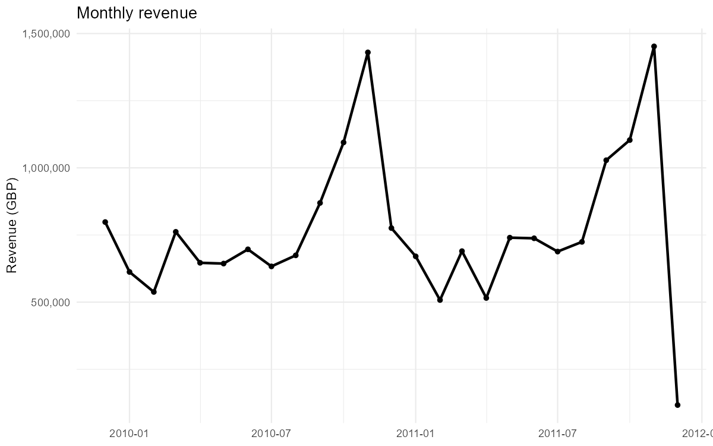
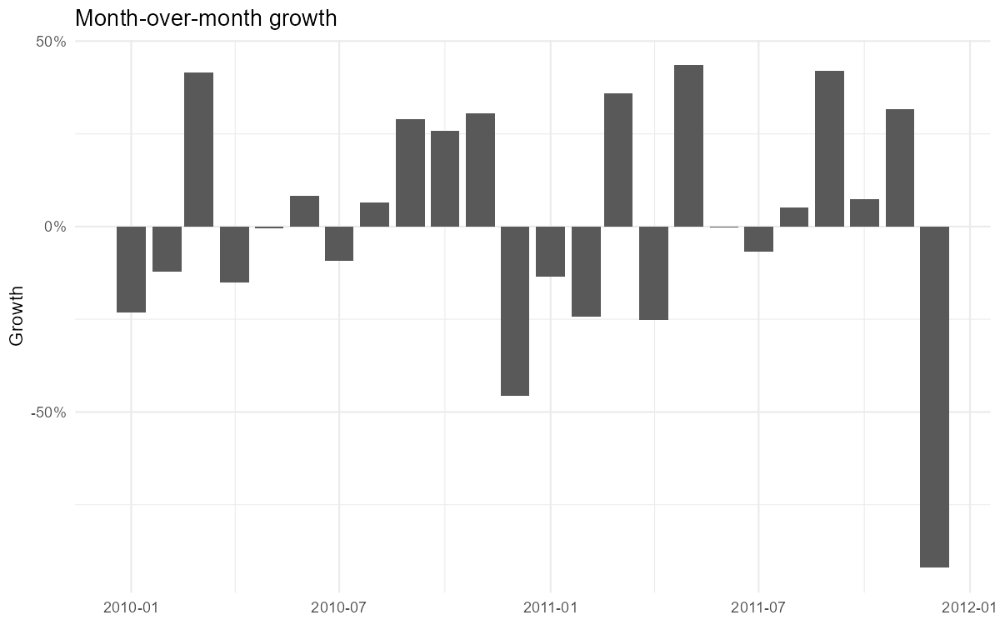

---

---
title: "Executive Sales Performance Report"
subtitle: "Retail Pulse Kerala"
author: "Retail Analytics Team"
date: "`r Sys.Date()`"
output:
  html_document:
    toc: true
    toc_depth: 2
    theme: readable
    code_folding: hide
---

```{r setup, include=FALSE}
knitr::opts_chunk$set(echo = FALSE, warning = FALSE, message = FALSE)

kpi <- read.csv("kpi_summary.csv")
monthly <- read.csv("datatable_monthly_sales.csv")
```

# 1. Business Problem

Retail managers need to understand sales performance, revenue trends, and business growth to make better decisions.

This report summarizes the sales performance of Retail Pulse Kerala and identifies areas that require management attention.

# 2. Dataset Description

The analysis uses the cleaned retail sales dataset containing 985,151 records.

The dataset includes invoice details, product information, quantities, revenue, and transaction dates.

# 3. Methodology

The analysis includes:

- Data cleaning and validation.
- Revenue and quantity calculations.
- Monthly sales analysis.
- Sales KPI evaluation.
- Trend visualization.

# 4. Analysis and Visualizations

## Overall Sales Performance

```{r}
knitr::kable(kpi, caption = "Sales KPI Summary")
```

## Monthly Revenue

```{r}
knitr::kable(head(monthly, 12), caption = "Monthly Revenue Summary")
```

```{r, out.width="90%"}

```

## Monthly Growth

```{r, out.width="90%"}

```

# 5. Key Findings

The cleaned dataset contains 985,151 sales records.

The previously calculated business KPIs indicate:

- Total revenue: GBP 19,148,015.
- Total orders: 38,975.
- Average order value: GBP 491.
- Sales growth from January to November 2011 compared with the same period in 2010: 3%.

# 6. Business Implications

Sales performance provides management with information about revenue generation, customer purchasing activity, and changes in demand.

Monthly revenue trends can help managers identify stronger and weaker sales periods.

# 7. Recommendations

- Monitor monthly revenue regularly.
- Identify products contributing the highest revenue.
- Investigate periods with declining sales.
- Use sales trends when planning inventory.
- Review business performance through regular KPI dashboards.

# 8. Limitations

- The analysis depends on the quality of the available transaction data.
- Some customer information is missing.
- The findings describe historical performance and do not guarantee future results.
- Cost information is available for only a portion of products.
